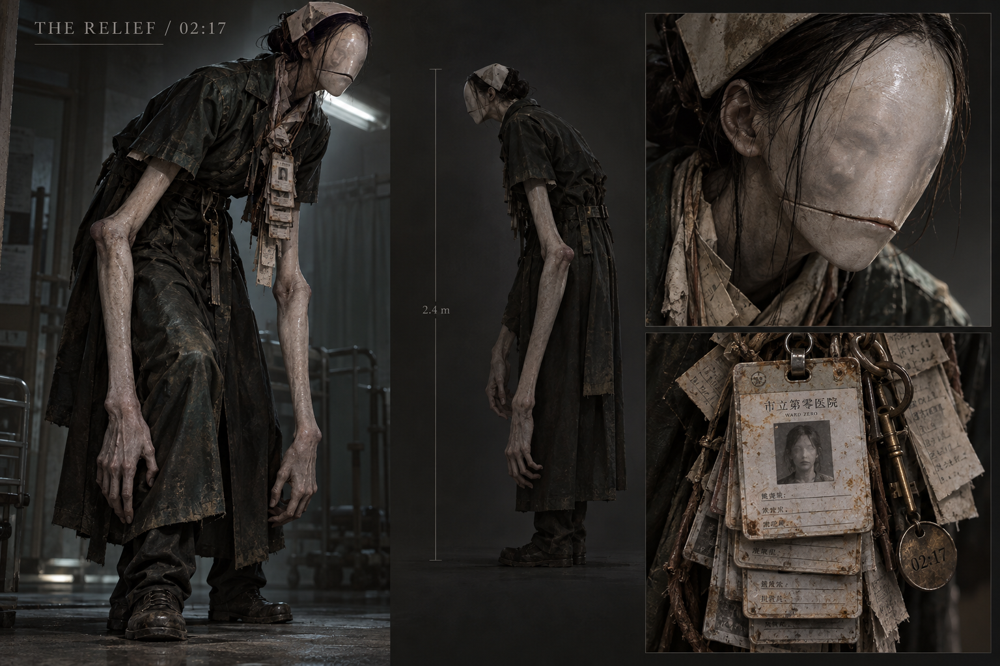

# 代班者 / THE RELIEF

**本页原始概念图保留作设计资料，网页不读取本目录。2026-10-28 按用户后续要求，已用简化的低多边形模型接入代班者，未使用写实面部或血肉贴图。**

当前实机：巡查 2.25、调查声源 3.3、追逐 5.65 米/秒；站立开灯可在 15 米视线内暴露。脱离视线后跟进最后位置约 7 秒，再搜查 5 秒。凝视增加紧张与心跳，移开视线逐渐恢复。近身抓到播放 680 毫秒的简化错位脸，随后回到恢复面板，保留道具、机关和地图。设置中可分别关闭突脸与风格化血污。下面的写实原画和更复杂行为仍是早期参考，不代表最终实机画风。

## 外形与恐怖来源

它不是烂脸冲刺的普通怪物。它是一个努力装成“来接你班的人”的东西：约 2.4 米高，挤进普通门框时把肩和脖子折下去；旧护工服袖子太短，手却够到膝盖下面。脸像糊平的蜡面，下面还压着另一张脸的浅痕。没有红眼，也不靠血浆。

胸前挂一长串工牌，每张照片都像林秋，名字、班次和磨损程度却不同。衣领夹着揉皱的交接单，走起来先听到纸擦衣服，再听到鞋底。它不是要吃人，而是急着让一个活人承认：“我接你的班，你可以走了。”

概念图重点表达不对劲的比例和身份重复；不是可直接投入游戏的模型，也不是正式尺寸蓝图。

## 预留行为设计——本轮没有实现

- 第一次出现只让玩家在明确可撤离的走廊尽头看见完整轮廓。不放在打开纸条的瞬间贴脸。
- 它学玩家刚走过的动作，但慢半拍。追逐中仍依赖实体路线、视线、声源和门，不瞬移穿墙。
- 它会说工作相关的话，但答不上私人问题。声音像隔着护士站玻璃，语气先客气，随后急躁。
- 句子：“你先签。先签就能走。我也想走。怎么每次都是我留下？”
- 句子：“小满？哪个床的？你别问名字。告诉我床号就行。”
- SAN 方向：持续盯着它时工牌文字短暂重复、广播错喊名字，移开目光到安全区后恢复。保留真实导航、碰撞、按键与线索内容，不反转输入，不随机改密码。应提供低刺激选项并避免闪屏。
- 这些行为、语音、SAN 反馈、模型和动画都停留在方案阶段。当前演示连旧追逐者 AI 与模型也关闭了。

## 图像生成记录

方式：内置 imagegen，单张原创概念图，无参考图片。输出：`the-relief-concept.png`。

最终生成提示词：

> Create an original professional psychological survival horror enemy concept sheet for an abandoned Chinese hospital game WARD ZERO. This is ONLY an offline design artifact, not a game asset or runtime integration. Landscape concept sheet with one large fully visible three-quarter body portrait, a smaller side silhouette, and two close-up studies of the face and identification badge. Character title small tasteful text: 'THE RELIEF / 02:17'. A terrifying unnatural night-shift replacement worker, adult humanoid 2.4 metres tall, extremely long forearms, subtly wrong reversed elbow bend, folded angular posture as if trying to fit a normal doorway, an old charcoal nurse/orderly coat with sleeves too short. Blank waxy porcelain facial plane where eyes should be, a narrow horizontal seam displaced too low on the face, a second shallow face impression visible under the stretched mask; no cute rabbit features, no smile, no glowing red eyes, no generic zombie. A vertical stack of faded staff badges all bearing the same obscured face, dangling keys, frayed shift handover slips accumulating like layered paper under the collar. Flesh muted grey wax, coat matte black-green, rust and dirty ivory accents. Moody dark neutral concept-art background, cinematic restrained hospital fluorescent rim lighting, realistic painterly material studies, highly readable full silhouette, quietly disturbing nonhuman anatomy and identity confusion. No gore, no exposed viscera, no injury depiction, no action attack, no jump-scare closeup, no extra characters. Keep annotations minimal and English only. High-end original game preproduction art, no franchise imitation, no watermark.
